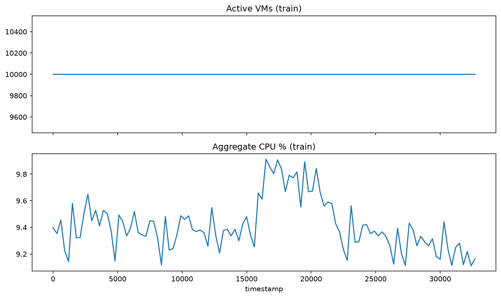
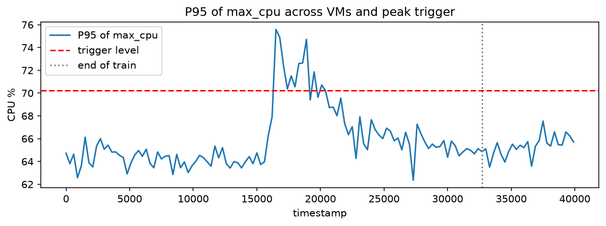
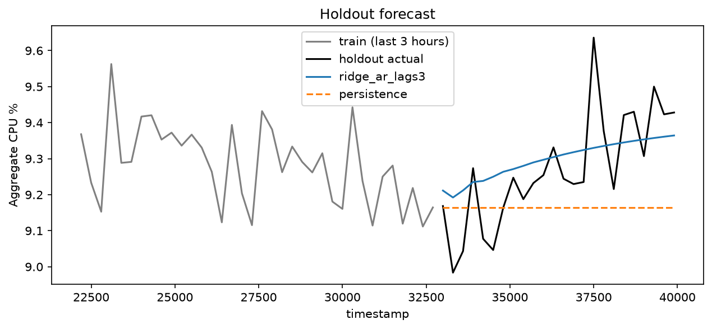
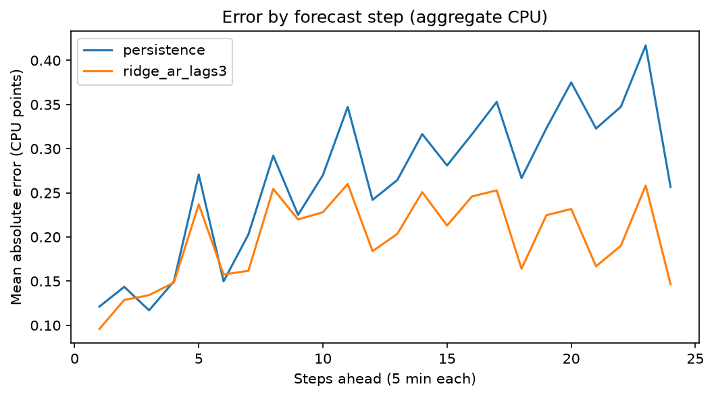

# Cloud Workload Forecasting - Final Report

Mohamed Rayen Sansa - AI/ML Engineering Intern take-home, Atomity

## 1. Executive summary

**Question:** how predictable is this cloud workload, how well can the next 2 hours be forecast,
and what should an infrastructure team do with the forecast?

**Answer in short:**

- At fleet level, the workload is very stable. Over 9 hours of training data, the aggregate CPU stays between
  9.1% and 9.9% (standard deviation 0.19 points). The VM count does not move at all (10,000), because the dataset
  keeps only VMs with a complete trace.
- A simple ridge autoregression on the last 3 values beats the persistence baseline:
  **25% lower MAE in rolling-origin validation** (0.198 vs 0.266 points) and **33% lower on the holdout**
  (0.098 vs 0.147). The gain is real but not uniform: the model wins on 4 of 7 validation folds.
- The model mainly works because it pulls the forecast back toward the recent mean. It does not predict
  short spikes, and it would follow a lasting level change late.
- **Recommendation:** plan for forecast + 0.20 CPU points (about 2% of the load) in normal mode,
  and raise the headroom to +0.45 points when the P95 of `max_cpu` across VMs goes above 70.2%.
  On the holdout, the normal plan covered 23 of 24 steps.

## 2. Data understanding

The `data-v1` release has two files: 1,340,000 CPU readings (10,000 VMs x 134 timestamps) and one metadata row per VM.

| Check                           | Result                                                         |
| ------------------------------- | -------------------------------------------------------------- |
| Time grid                       | 134 timestamps, exactly 300 s apart, no gap (about 11.1 hours) |
| Coverage                        | every VM reports at every timestamp                            |
| Missing values                  | none                                                           |
| Duplicate `(vm_id, timestamp)`  | none                                                           |
| `avg_cpu` outside 0-100         | none                                                           |
| `min_cpu <= avg_cpu <= max_cpu` | true on every row                                              |

The data card confirms why the data is so clean: only VMs with a complete trace were eligible,
then 10,000 VMs were selected with stratification by category and core count.

**Preprocessing rules** (in `src/cwfc/data.py`, kept in the pipeline even though the release needs no cleaning):

- **Valid observation:** a row with a timestamp, a `vm_id` and `avg_cpu` between 0 and 100. Invalid rows are dropped, never corrected.
- **Duplicates:** a VM counts once per timestamp; the first row is kept.
- **Gaps:** missing timestamps are reported, not filled. Target values are never imputed.

**Targets:** `active_vm_count` = number of distinct VMs with a valid reading at each timestamp;
`aggregate_cpu_utilization` = mean `avg_cpu` across those VMs. The full 134-point series is built first,
then split: the first 110 timestamps for training, the last 24 (2 hours) as the holdout.

## 3. Workload analysis

All pattern analysis uses the training window only.

**Targets.** The VM count is flat at 10,000. Aggregate CPU averages 9.41% with a standard deviation of 0.19 points.
There is one bump of about +0.4 points between t=16,000 and t=22,000 (about 4.5 to 6 hours into the trace),
then the level comes back down. Nine hours are too short to see any daily pattern.



**Churn.** No VM starts or stops in the window: all VMs are created at t=0 and the earliest deletion (40,500 s)
is after the end of the trace. Real churn is invisible in this dataset.

**CPU distribution.** Most VMs are almost idle: the median reading is 5.1%, and 46% of VMs average below 5%.
Only 2.2% of VMs average above 50%, but the 99th percentile reading is 87%. The fleet mean (9.4%) is almost twice
the median, so a small group of busy VMs drives the aggregate.

**Segments.**

| VM category       | VMs   | Mean CPU |
| ----------------- | ----- | -------- |
| Delay-insensitive | 6,180 | 8.3%     |
| Interactive       | 3,091 | 11.5%    |
| Unknown           | 729   | 10.4%    |

Interactive VMs run hotter. The bump comes from the delay-insensitive group, while the unknown group drifts down
from about 11% to 9.5% over the window. The largest size buckets (>24 cores, >64 GB) have only 10 VMs, too few to conclude.

**Peaks.** The highest load is between t=16,500 and t=20,400. During the bump the average moves by only 0.4 points,
but the P95 of `max_cpu` across VMs jumps from about 64% to 75%. **Peaks are far more visible in the tail
than in the average.** This finding drives the peak trigger in section 8.



**How predictable is the workload?** At fleet level, very predictable in level: the series stays in a narrow band.
Its short-term movements are mostly noise around a slowly moving level, which is hard to predict.
At VM level the load is very uneven, and capacity risk sits in the busy tail, not in the average.

## 4. Approach

The models take only past values of the target. No VM metadata is used as a feature: fields such as the
deletion time and VM-level CPU statistics describe the whole life of the VM, including the future,
so they would leak information.

Candidates (all in `src/cwfc/models.py`):

- **Persistence** (baseline): repeat the last value.
- **Moving average** over the last 6, 12 or 24 values (30 min, 1 h, 2 h).
- **Ridge autoregression** with 3, 6 or 12 lags. The series is standardized, a linear model is fitted on the
  previous values with a ridge penalty (alpha = 1), and the 24 steps are forecast one after the other.
  The penalty keeps the model small and pulls forecasts toward the mean when the lags carry little signal.

I kept the list short on purpose: with 110 points, testing many settings would end up selecting a lucky model.
Deep models (LSTM, Transformer) would overfit this little data.

**VM count:** every candidate gives zero error on a constant series, so I use persistence, the simplest one.

## 5. Validation

**Design:** rolling origin on the 110 training timestamps. At each origin, the model sees only the past and
forecasts the next 24 steps, the same horizon as the holdout. The first origin is at 48 timestamps (4 hours of
history), and origins move forward by 6 steps (30 minutes): 7 folds in total.

**Why this design:** it copies production, where the team forecasts the next 2 hours with the data available now.
A single split would depend on the chosen moment; 7 folds give a more reliable picture without using the future.
No random split is used.

**Leakage controls:**

- The holdout is never used for fitting, model selection, tuning or the capacity headroom.
- A unit test replaces the holdout values with arbitrary numbers and checks that the predictions do not change.
- Another test checks that each validation fold only receives data before its origin.

## 6. Results versus baseline

**Validation (7 folds, aggregate CPU):**

| Model             | MAE       | RMSE      | MAE std across folds | Folds won vs persistence | MAE vs persistence |
| ----------------- | --------- | --------- | -------------------- | ------------------------ | ------------------ |
| ridge_ar_lags3    | **0.198** | **0.241** | 0.073                | 4 / 7                    | 0.75               |
| ridge_ar_lags6    | 0.202     | 0.244     | 0.069                | 4 / 7                    | 0.76               |
| ridge_ar_lags12   | 0.244     | 0.289     | 0.075                | 5 / 7                    | 0.92               |
| moving_average_6  | 0.253     | 0.305     | 0.105                | 4 / 7                    | 0.95               |
| persistence       | 0.266     | 0.317     | 0.112                | -                        | 1.00               |
| moving_average_12 | 0.269     | 0.312     | 0.097                | 4 / 7                    | 1.01               |
| moving_average_24 | 0.279     | 0.311     | 0.066                | 2 / 7                    | 1.05               |

**Choice:** `ridge_ar_lags3`. It has the lowest MAE and RMSE, and it is more stable across folds than persistence.
The 6-lag version is almost as good, so I keep the simpler one. The 12-lag version wins more folds but loses
more on average, so it is not better overall. The choice was fixed before looking at the holdout.

**Holdout (24 steps, scored once):**

| Model          | MAE       | RMSE      | sMAPE     | Max error | MAE vs persistence |
| -------------- | --------- | --------- | --------- | --------- | ------------------ |
| ridge_ar_lags3 | **0.098** | **0.119** | **1.06%** | **0.31**  | 0.67               |
| persistence    | 0.147     | 0.185     | 1.59%     | 0.47      | 1.00               |

The VM count forecast is exact (MAE 0).



Holdout error is about half the validation error. The holdout is a calmer period than the bump in the training
window, so I do not read this as a true improvement: with 24 points, the validation results are the more reliable measure.

## 7. Error analysis

**Error by horizon (validation).** Both models are close for the first 4 steps (20 minutes).
After that, persistence error keeps growing (up to about 0.42 points), while the ridge error stays lower
(around 0.25 at most), because it pulls the forecast back toward the mean instead of carrying the last value forward.



**Bias (holdout).** Persistence under-forecasts on 79% of steps (mean error -0.10 points): used for capacity,
it would under-provision most of the time. The ridge model is almost unbiased (+0.03) and under-forecasts on 38% of steps.

**Peaks.** Only 1 of 24 holdout timestamps is above the peak threshold (the 75th percentile of training CPU, 9.51%).
On that point the model error is 0.31 vs 0.47 for persistence. One point is not enough to judge peak behaviour;
the validation folds, which cover the bump, are the better evidence.

**Failure modes.**

1. **Short dips:** at the start of the holdout the series drops to about 9.0%; the model is about 0.2 points too high.
2. **Single-step spikes:** the 9.64% spike at t=37,500 is missed by 0.31 points. The model does not predict spikes.
3. **Mean reversion:** the model assumes the level goes back to the training mean. A lasting shift,
   like the bump in the training window, would be followed late.

**Percentage metrics.** sMAPE divides by |actual| + |forecast|. Aggregate CPU stays around 9%, far from zero,
so the denominator is safe; the metric also has a small epsilon guard. For the constant VM count, only MAE is reported.

## 8. Capacity recommendation

**Principle:** planning exactly for the forecast runs short about half of the time. The plan is
**forecast + headroom**, where the headroom is a percentile of the model's under-forecast errors in validation.
The holdout is only used to check the plan.

**Cost assumption:** running short of capacity costs 5 times more than idle capacity (slowdowns and unhappy
customers vs paying for unused resources). With this ratio, the best coverage in theory is
5 / (5 + 1) = 83% (the newsvendor rule), which points to the 80th percentile.

**Headroom levels, checked on the holdout:**

| Level   | Headroom (points) | Coverage  | Mean shortfall | Mean unused capacity | Cost      |
| ------- | ----------------- | --------- | -------------- | -------------------- | --------- |
| q50     | 0.00              | 62.5%     | 0.035          | 0.063                | 0.238     |
| **q80** | **0.20**          | **95.8%** | **0.004**      | **0.234**            | **0.256** |
| q90     | 0.40              | 100%      | 0              | 0.424                | 0.424     |
| q95     | 0.45              | 100%      | 0              | 0.482                | 0.482     |
| q99     | 0.53              | 100%      | 0              | 0.561                | 0.561     |

q50 has the lowest cost on this holdout, but only because the holdout is calm, and it leaves the plan short on
more than a third of the steps. I do not pick the headroom from holdout results.

**Peak trigger:** the average hides peaks, but the P95 of `max_cpu` across VMs shows them. The trigger level is
the 90th percentile of that signal in training: 70.2%. It fired on 11 training timestamps, all during the main
part of the bump (t=16,500 to 20,100), and never in the holdout. It fires at the start of the bump, not before:
it is a fast detector, not a predictor.

**Policy:**

1. **Normal mode:** plan aggregate CPU = forecast + 0.20 points (q80). On the holdout this covered 23 of 24 steps
   with about 2% extra capacity; the only miss is the 9.64% spike.
2. **Peak mode:** when the P95 of `max_cpu` goes above 70.2%, raise the headroom to +0.45 points (q95)
   until it falls back below the level.
3. **VM count:** plan for the current count, and check this rule on data with real churn.
4. **Monitoring:** recompute the headroom and the trigger level regularly on recent data,
   and raise the headroom if coverage over the last day drops below 80%.

**Trade-off:** less headroom saves money but risks slowdowns; more headroom is safer but pays for idle capacity.
A team with stricter latency targets should use q90 (+0.40 points).

## 9. Limitations

- **Short window:** 11 hours, so no daily or weekly seasonality, and only one bump to learn from.
- **No churn:** the dataset keeps only complete traces, so the VM count is constant and its forecast says nothing
  about real fleets, where VMs are created and deleted.
- **Small holdout:** one 2-hour window with a single peak point. The validation folds are the more reliable evidence.
- **Fleet average only:** the targets average 10,000 VMs. Real scaling decisions happen per service or per VM,
  where the load is much more uneven.
- **Assumed cost ratio:** the 5:1 ratio should come from the infrastructure team (contract penalties, machine prices).
- **Next steps:** forecast per VM category and sum the results, add prediction intervals,
  and test the approach on a longer trace with churn.

## Appendix - Reproducibility

```bash
pip install -e ".[dev]"
python -m cwfc.pipeline --data challenge_data --output predictions.csv
pytest -q    # 27 tests
```

The notebooks in `notebooks/` reproduce every table and figure in this report, in order 01 to 04.
